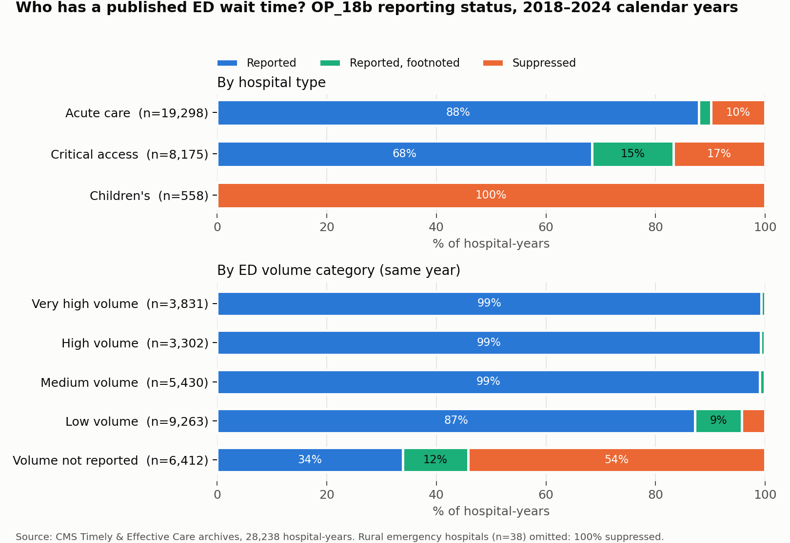

# How much of an ER's wait time is structural?

A study of US emergency department throughput using seven years of public CMS hospital quality data.

**Status:** in progress. Data pipeline, data quality audit and baselines are done. Modeling is next.

## The question

Some people argue hospitals should post ED wait times so patients feel less anxious and can choose where to go.
That only helps if the number tells you something you couldn't already guess. This project asks how much of a
hospital's ED time is a stable property of the hospital (its size, type, location, the county around it) and how
much changes from year to year.

The measure is CMS **OP-18b**: the median time patients spend in the ED before leaving, excluding psychiatric
patients and transfers. It is published per hospital as a rolling 12-month figure.

## Data

- 34 archived snapshots of the CMS Provider Data Catalog hospital files, March 2019 to September 2026
  (`data/manifest.csv`). 33 contain the Timely and Effective Care file.
- USDA Rural-Urban Continuum Codes 2023, Census 2023 Gazetteer and 2020 ZCTA-county files, ACS 2022 5-year county profile.
  Sources and retrieval dates: `data/external_sources.md`.

Raw and intermediate data are not committed. Everything is rebuilt from the manifest with the scripts in `src/`.

## Findings so far

**Snapshots are not independent observations.** CMS publishes rolling 12-month windows that move forward one quarter
at a time, so neighbouring snapshots share 9 of 12 months. The 33 files contain 28 distinct OP-18b windows and only
6 non-overlapping calendar years: 2018, 2019, 2021, 2022, 2023, 2024. There is no 2020 because CMS never reported
the first half of that year. ([recon](reports/01_data_recon.md))

**CMS revises published numbers.** When a window was republished in a later snapshot, 25% of OP-18b values changed,
by up to 64 minutes. The panel always uses the latest version. ([panel](reports/04_panel.md))

**Missing data is not random.** 13.8% of hospital-years have no published OP-18b. Critical access hospitals are 5.7
times as likely to be suppressed as acute care hospitals, and physician-owned and tribal hospitals far more so. Low-volume
EDs are where the gaps are. Dropping hospitals with gaps would remove faster, smaller EDs and bias the sample, so they
stay in. ([suppression audit](reports/05_suppression.md))



**ED time is very persistent.** Non-overlapping calendar years correlate at r = 0.94 (log scale), with a typical change
of 9 minutes. Even 2018 against 2024 correlates at 0.82. ([target exploration](reports/07_target_eda.md))


## Baselines (frozen, 2024 test year)

| Baseline | Hospitals | MAE (min) | Rank correlation |
|---|---|---|---|
| Last year's value | 3,997 | 11.9 | 0.953 |
| State and hospital type median, hospitals not seen in training | 832 | 29.0 | 0.675 |

Any model has to be compared against these. Details and confidence intervals: [baselines](reports/09_baselines.md).

## Next

- Structural model: how much of the gap between 29.0 and 11.9 minutes is explained by what a hospital is, for hospitals it has never seen
- Forecasting model against the last-year baseline
- Fixed-effects split of variance into between-hospital and within-hospital
- Nearest-alternative-ED comparison, prediction intervals, error by hospital type and rurality

## Reproduce

```bash
python -m venv .venv && source .venv/bin/activate
pip install -r requirements.txt
python src/build_manifest.py
python src/download_all.py
PYTHONPATH=src python src/recon_schema.py
PYTHONPATH=src python src/build_long.py
PYTHONPATH=src python src/build_panel.py
PYTHONPATH=src python src/build_hospital_attrs.py
PYTHONPATH=src python src/suppression_audit.py
PYTHONPATH=src python src/build_geo.py
PYTHONPATH=src python src/build_analysis_table.py
PYTHONPATH=src python src/baselines.py
PYTHONPATH=src python -m pytest tests -q
```

The county joins need the files listed in `data/external_sources.md` in `data/external/`. The ACS file needs a free
Census API key.

## Layout

```
src/        pipeline, splits, features, metrics, baselines
tests/      split and leakage tests
reports/    one write-up per step, plus figures
data/       manifest and source list (raw data not committed)
```
