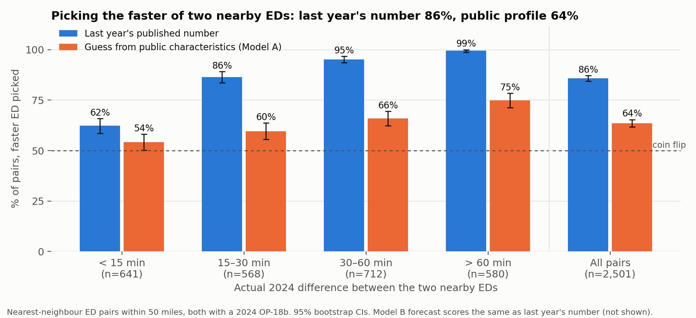
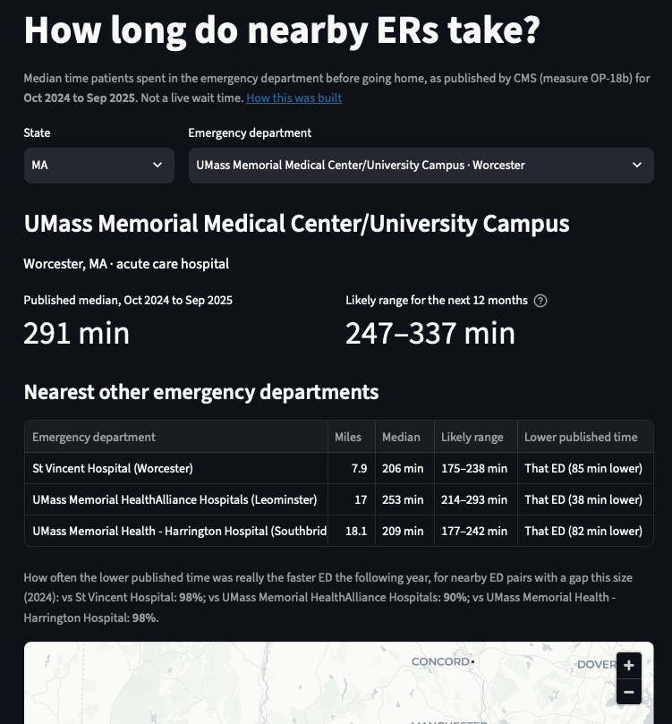
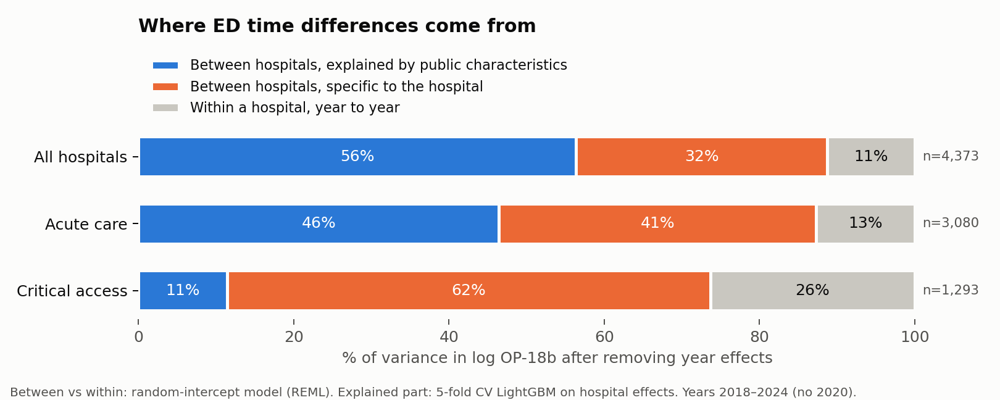
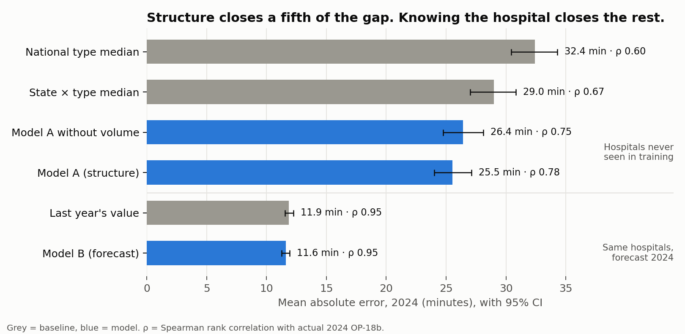
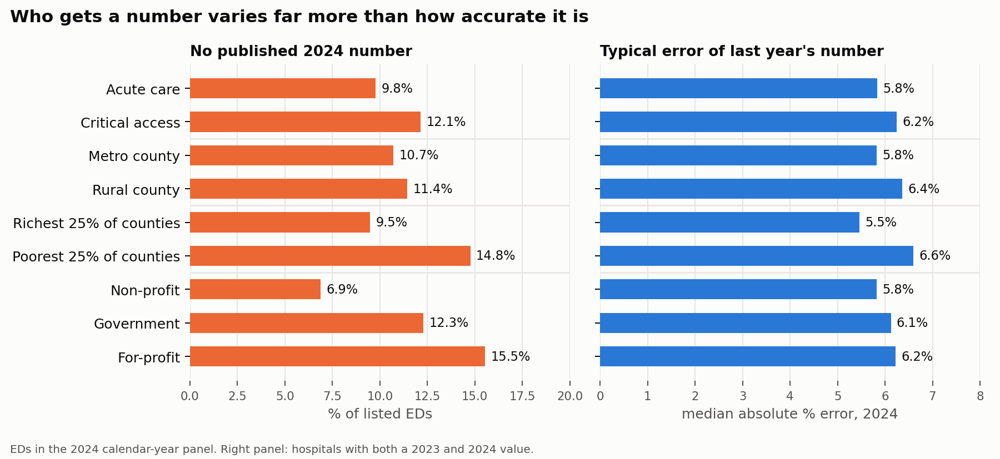

# Does a hospital's posted ER time tell patients anything?

A study of US emergency department throughput using seven years of public CMS hospital quality data.

**Live app: [er-times.streamlit.app](https://er-times.streamlit.app)** · Author: Omkar Badadale ([portfolio](https://omkarb40.github.io), [GitHub](https://github.com/omkarb40))

**Built with:** Python, pandas, Parquet, LightGBM, SHAP, statsmodels (fixed effects, mixed models),
split conformal prediction, scikit-learn, pytest, Streamlit, Docker.

## Short answer

Yes. If two emergency departments are near each other, the one with the lower published time last year was the
faster one this year **86% of the time**, and following it saves a patient about **18 minutes** on average compared with
picking at random. No model meaningfully improved on it: the best forecast gained 16 seconds. A guess from everything
public about a hospital (type, size, location, county income, insurance and age) picks the faster ED only **64%** of the
time.

The number is a yearly median of arrival to departure, including treatment. It ranks EDs; it does not say how long you
will wait tonight.

The catch is who gets a number. Hospitals with no published value are disproportionately small, rural, for-profit and
in poorer counties: the places where patients have the fewest alternatives.



## The app

**[er-times.streamlit.app](https://er-times.streamlit.app)** (`app/streamlit_app.py`): pick an emergency department and see its latest CMS number with a range for the next 12 months,
its three nearest other EDs, and how often the lower published number has actually been the faster ED.

- **3,914 EDs** show their current published number (Oct 2024 to Sep 2025) and a 90% range.
- **48 EDs** have no current number but one from the last four years; the app shows that older number, dated, with a
  wider range (back-tested coverage 86% to 90%, stated in the app).
- **212 EDs** have no recent number; the app shows an estimate from the hospital's public profile, clearly labelled.
- Every ED without a current number carries a warning to check it is open: CMS's list can include closed EDs
  (e.g. Nashoba Valley Medical Center, which closed in August 2024).



Run locally:

```bash
pip install -r app/requirements.txt
python -m streamlit run app/streamlit_app.py
```

or with Docker: `docker build -t ed-app app && docker run -p 8501:8501 ed-app`.

The app reads only the small files in `app/data/` (built by `src/build_app_data.py`), so it needs no model library.

## The question

The measure is CMS **OP-18b**: the median time patients spend in the ED before leaving, for discharged patients,
excluding psychiatric patients and transfers. It is a yearly median that includes treatment time, not a live wait time.

Some argue hospitals should post ED times so patients can choose. That only helps if the number carries information a
patient could not already guess. This project measures how stable the number is, how much of it can be predicted from
public characteristics, and whether it would actually have pointed patients to the faster of two nearby EDs.

## Findings

**1. ED time is a stable property of each hospital.** Almost 9 of every 10 units of variation in ED time are differences
between hospitals; only about 1 in 10 is year-to-year change within a hospital. Consecutive years correlate at r = 0.94.
([variance decomposition](reports/11_fe_results.md), [target study](reports/07_target_eda.md))

**2. Public characteristics explain some of it, not all.** Hospital type, state and ED volume explain most of what
public data can explain. For critical access hospitals they explain only 15% of the differences between hospitals;
the rest is specific to the individual hospital.



**3. Last year's number is the forecast.** A LightGBM forecast beat "same as last year" by 0.27 minutes (about 16
seconds). A model that only knows a hospital's public profile is off by 25.5 minutes on hospitals it has never seen,
against 11.9 for last year's number. ([models](reports/10_models.md))



**4. Honest ranges work.** 90% prediction intervals around last year's number (typically ±25 minutes) covered 91% of
2024 values, after calibration on 2023 only. They are too narrow for hospitals whose last number carried a CMS footnote
(80% coverage) unless those get their own, wider calibration. ([intervals](reports/14_intervals.md))

**5. The gap is who gets a number, not how good it is.** When a hospital has a number, its typical error is 5.5% to
6.6% in every group studied. But for-profit EDs and EDs in the poorest quarter of counties are more than twice as likely
as non-profits to have no published value. ([slices](reports/15_slices.md), [suppression audit](reports/05_suppression.md))



## Data quality findings along the way

- CMS snapshots are not independent: rolling 12-month windows move a quarter at a time, so 33 snapshot files contain
  only 6 non-overlapping calendar years (2018, 2019, 2021 to 2024; no 2020). ([recon](reports/01_data_recon.md))
- CMS revises published numbers: 25% of OP-18b values changed when a window was republished, by up to 64 minutes.
  ([panel](reports/04_panel.md))
- Missing values are not random: critical access hospitals are 5.7 times as likely to be suppressed as acute care
  hospitals, so dropping incomplete hospitals would bias the sample. ([suppression audit](reports/05_suppression.md))

## Methods in brief

| Step | What | Report |
|---|---|---|
| Data | 34 CMS archive snapshots (2019 to 2026), USDA rurality codes, Census geography, ACS county data | [01](reports/01_data_recon.md), [02](reports/02_loader.md), [06](reports/06_geo_joins.md) |
| Panel | 375,784 hospital × window × measure rows; latest revision of each window | [04](reports/04_panel.md) |
| Splits | Forecast split by year; structural split by year **and** hospital, with leakage tests that were checked to fail on purpose | [08](reports/08_splits.md) |
| Baselines | Last year's value; state × type median | [09](reports/09_baselines.md) |
| Models | LightGBM on log ED time relative to the national median; paired bootstrap comparisons | [10](reports/10_models.md) |
| Variance | Two-way fixed effects plus a random-intercept model to correct for noisy hospital averages | [11](reports/11_fe_results.md) |
| Decision test | 2,980 nearest-ED pairs; would the numbers have picked the faster ED in 2024? | [13](reports/13_decision.md) |
| Intervals | Split conformal, calibrated on 2023, per-group calibration | [14](reports/14_intervals.md) |
| Fairness | Error, coverage, decision accuracy and missing data by group | [15](reports/15_slices.md) |
| Attribution | Exact TreeSHAP on the public-profile model | [16_shap.csv](reports/16_shap.csv) |

## Limits

- OP-18b is a yearly median of arrival to departure, including treatment. It ranks EDs; it does not tell you how long
  you will wait tonight.
- Distances are between ZIP centroids, not driving times; each ED is compared with one alternative.
- County income, insurance and age describe the county, not a hospital's patients.

## Reproduce

```bash
python -m venv .venv && source .venv/bin/activate
pip install -r requirements.txt
python src/build_manifest.py
python src/download_all.py
export PYTHONPATH=src
python src/inventory_zips.py
python src/recon_schema.py
python src/recon_op18.py
python src/build_long.py
python src/build_panel.py
python src/build_hospital_attrs.py
python src/suppression_audit.py
python src/build_geo.py
python src/build_analysis_table.py
python src/target_eda.py
python src/split_report.py
python src/baselines.py
python src/models.py
python src/fe_decomposition.py
python src/fe_feature_groups.py
python src/build_pairs.py
python src/decision_eval.py
python src/conformal.py
python src/slices.py
python src/shap_profile.py
python src/build_app_data.py
python src/make_figures.py
python -m pytest tests -q
```

County joins need the files in `data/external_sources.md` saved to `data/external/`; the ACS file needs a free Census
API key. Raw and intermediate data are not committed.

## Layout

```
src/        pipeline, splits, features, metrics, models, figures
tests/      split and leakage tests
reports/    one write-up per step, plus figures
app/        Streamlit app, its data and Dockerfile
docs/       app screenshot
models/     fitted public-profile model used to build the app data
data/       manifest and source list (raw data not committed)
```
