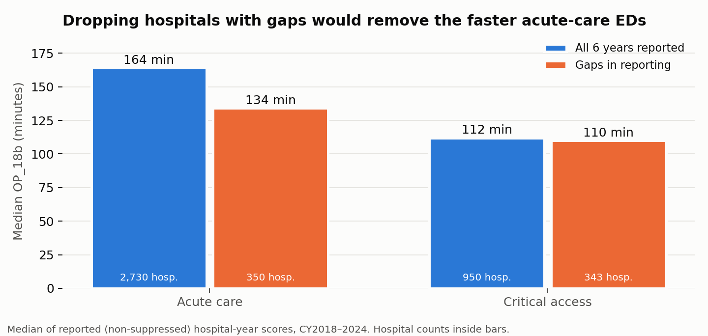

# S5 — Suppression audit

Run 2026-10-25. Code: `src/build_hospital_attrs.py`, `src/suppression_audit.py`, `src/fig_suppression.py`.
Outputs: `reports/05_suppression.json`, `reports/05_suppression_logit.csv`, `reports/figures/05_*.png`,
`data/interim/op18b_status.parquet`, `data/interim/hospital_attrs_latest.parquet` (git-ignored).

## Gate verdict: missingness is NOT random. Do not drop incomplete hospitals.

Unit: hospital × calendar year (OP_18b, CY2018/19/21–24). 28,238 hospital-years:
**22,705 reported (80.4%) · 1,648 reported but footnoted (5.8%) · 3,885 suppressed (13.8%)**.

## Who is suppressed

| Group | Suppressed | Footnoted | n |
|---|---|---|---|
| Acute care | 9.9% | 2.2% | 19,298 |
| Critical access | 16.8% | 14.9% | 8,175 |
| Children's | 100% | — | 558 |
| Rural emergency hospital | 100% | — | 38 |
| ED volume medium / high / very high | ≤0.1% | ≤0.9% | 12,563 |
| ED volume low | 4.3% | 8.5% | 9,263 |
| ED volume not reported | 54.2% | 11.9% | 6,412 |
| No emergency services listed | 57.2% | 3.3% | 2,290 |

Logistic model, P(suppressed) ~ type + ED volume + ownership + year, acute + critical-access only,
n = 21,687, pseudo-R² = 0.212 (`05_suppression_logit.csv`). Odds ratios:
critical access vs acute **5.7**; medium / high / very-high volume vs low **0.086 / 0.085 / 0.042**;
physician-owned **22.6**, tribal **18.2**, proprietary **2.7** vs government; year effects all p > 0.19.

Read: suppression is a **small-hospital phenomenon** that is stable over time.
Suppression reasons: code 5 "not available for this period" (2,932), code 19 "not in IQR/OQR programs" (858),
too-few-cases/short-period combinations (~80).

## Dropping incomplete hospitals would bias the panel

3,680 hospitals have a reported OP_18b in all 6 years; 725 have gaps.

| | Hospitals | Median OP_18b | % critical access | % low-volume hospital-years |
|---|---|---|---|---|
| All 6 years | 3,680 | 148 min | 25.8 | 34.8 |
| Gaps | 725 | 120 min | 48.5 | 51.8 |

Within acute care the gap is 164 vs 134 min; within critical access it vanishes (112 vs 110).
So the bias runs through hospital size/volume, not reporting itself — consistent with the logit.
A balanced-panel analysis would overstate typical ED time and under-represent rural/small EDs.

## Decisions carried forward

1. **Analysis population:** Acute Care, Critical Access, and DoD acute hospitals. Children's and REH excluded
   (100% suppressed — structurally out of scope, stated in README, not silently dropped).
2. **Keep the unbalanced panel.** Fixed-effects estimation handles unbalanced panels; hospitals with a single
   reported year contribute nothing to within-hospital estimates and will be reported as such (151 hospitals).
3. **Footnoted-but-numeric scores (5.8%) stay in**, with an `is_flagged` covariate. Robustness check in S10/S11:
   re-run excluding them and report whether conclusions move.
4. **Results will be stratified acute vs critical access.** They differ in level (~150 vs ~110 min), in reporting
   behaviour, and the bias above runs through that split.
5. **README finding:** the hospitals with no published ED time are disproportionately small, rural,
   physician- or tribally owned — the EDs whose patients have the fewest nearby alternatives.

Caveat: hospital type/ownership are taken from each hospital's most recent General Information record.
A hospital that converted type (e.g. critical access → rural emergency hospital) is classified by its latest type.
