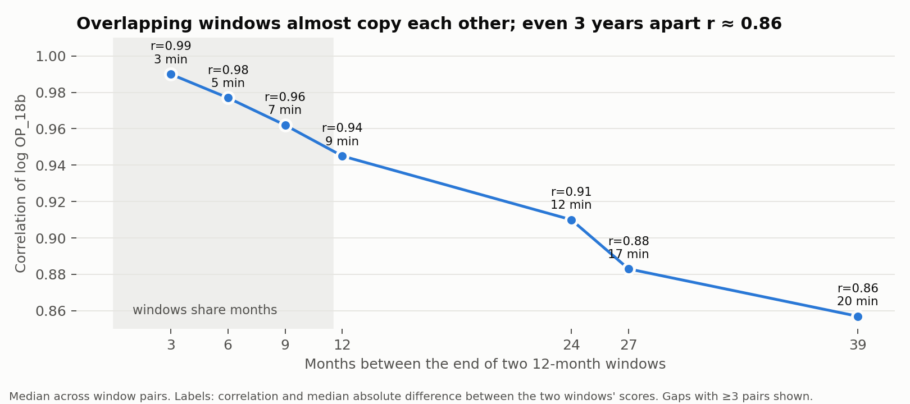
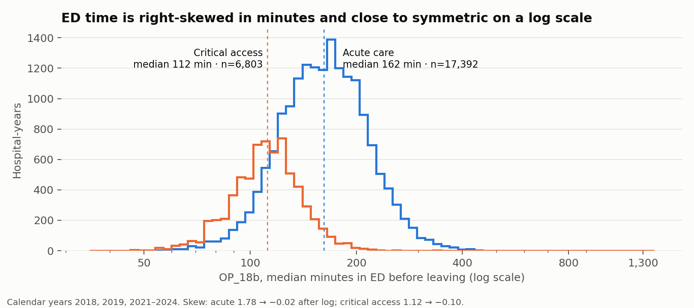

# S7 — Target EDA (OP_18b)

Run 2026-10-26. Code: `src/target_eda.py`, `src/fig_target.py`. Numbers: `reports/07_target_eda.json`.

## One-sentence answer to the gate

Two OP_18b windows 3 months apart share 9 of 12 months and agree at r = 0.99 (log scale, median difference 3 min);
two **non-overlapping** consecutive calendar years still agree at r = 0.94 (median difference 9 min).
So any split that lets overlapping windows straddle train/test leaks, and even a clean split faces a very strong
persistence baseline.

## Distribution

| Type | n | p5 | p25 | median | p75 | p95 | p99 | max | skew → skew(log) |
|---|---|---|---|---|---|---|---|---|---|
| Acute care | 17,392 | 101 | 134 | 162 | 196 | 256 | 318 | 1,344 | 1.78 → −0.02 |
| Critical access | 6,803 | 76 | 96 | 112 | 128 | 159 | 189 | 432 | 1.12 → −0.10 |
| DoD | 158 | 91 | 120 | 146 | 174 | 214 | 253 | 260 | 0.29 → −0.57 |

Median by year, acute care: 147 (2018), 149 (2019), 168 (2021), 174 (2022), 174 (2023), 170 (2024).
Critical access: 106, 107, 115, 115, 114, 114. The post-COVID rise is ~20 min for acute care, ~8 for critical access.

**Decision: model log(OP_18b).** Report errors back in minutes.

## Persistence (non-overlapping calendar years)

| Pair | Hospitals | r (log) | Median abs change |
|---|---|---|---|
| 2018 → 2019 | 3,962 | 0.935 | 8 min |
| 2021 → 2022 | 4,010 | 0.940 | 10 min |
| 2022 → 2023 | 3,968 | 0.947 | 9 min |
| 2023 → 2024 | 3,966 | 0.953 | 9 min |
| 2019 → 2021 (COVID gap) | 3,959 | 0.889 | 16 min |
| 2018 → 2024 | 3,742 | 0.816 | 21 min |

Checked that this is not a CMS carry-forward artifact: only 13 of 19,948 calendar-year rows repeat the previous
year's exact score **and** sample (0.07%); 1,273 of 108,579 rolling windows (1.2%) repeat the previous window.

**Implication for S9–S10:** "same as last year" will be a strong baseline. Beating it by a meaningful margin is
unlikely; the planned headline is the honest comparison, plus how much of the ranking survives without the lag (Model A).

## The `sample` column is not ED volume

Median 375, 61% of values between 300 and 450 — consistent with a chart-abstraction sample, not a patient count.
corr(log sample, log OP_18b) = 0.15. Volume comes from EDV, not `sample`.

## Outliers

- 44 hospital-years exceed Q3 + 3×IQR within their type; 2 are below 45 min.
- Extreme case: CCN 030137, CY2019 = 1,344 min from a sample of 132, footnote 3 (shorter period than required).
  Its other windows run 138–204, except three consecutive windows reporting an identical 475 min / 197 patients.
- Rule: flag hospital-years more than **2× their own leave-one-out median** as `implausible_jump` — 25 rows (0.1%),
  11 of them footnoted. Kept in the primary analysis (log scale absorbs most of the leverage); excluded in a
  robustness run. Flags saved in `data/interim/op18b_jump.parquet`.
