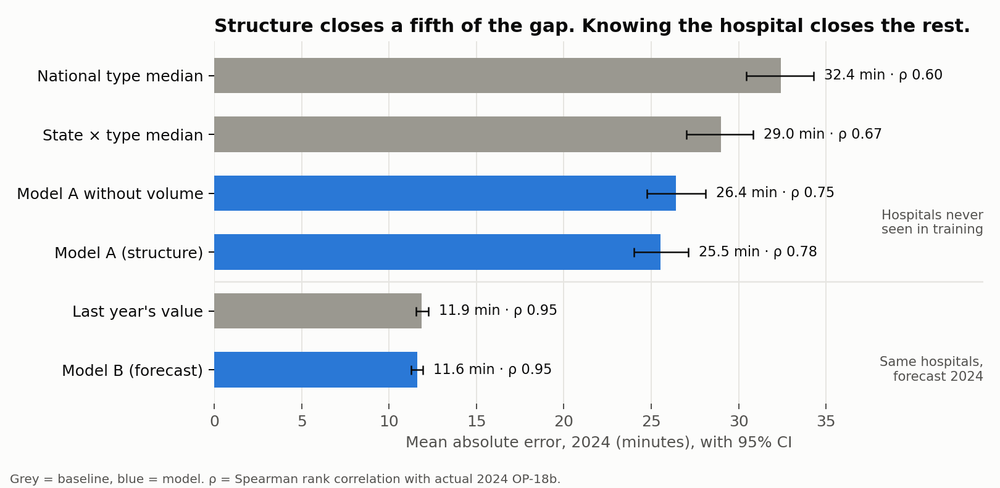

# S10: Models A and B against the baselines

Run 2026-10-28. Code: `src/models.py`, `src/fig_models.py`. Shared scorer: `src/metrics.py`.
Outputs: `reports/10_models.csv` (all metrics with 95% CIs), `reports/10_paired_diffs.csv` (paired bootstrap, 2,000
resamples), `reports/10_model_info.json` (chosen settings, feature gain), `data/interim/preds_2024.parquet`.

## Setup

Both models are LightGBM regressors on log OP-18b, measured relative to the national median so that neither can beat a
baseline by guessing the post-COVID level better.

| | Model A (structure) | Model B (forecast) |
|---|---|---|
| Question | Predict an ED it has never seen from what the hospital is | Forecast next year for a known hospital |
| Split | `grouped_temporal_split`: 832 unseen test hospitals | `temporal_split`: 3,997 test hospitals with a prior year |
| Target | log OP-18b minus the year's national median log | change from last year minus the year's median change |
| Level added back | 2022 national level from train hospitals (same information as B1) | none (same assumption as persistence) |
| Features | type, ownership, state, rurality, RUCC, emergency services, lat/lon, county population, income, % uninsured, % 65+, same-year ED volume category | same structural features + **prior-year** ED volume, prior-year left-without-being-seen, last value, gap to it, number of prior years, deviation of last value from own history |
| Not allowed | left-without-being-seen, psych OP-18c, footnote flags (outcomes of the same throughput) | anything from the target year |

Tuning: 9 settings (num_leaves 15/31/63 × min_child_samples 20/50/100), early stopping on 2023, refit on train + 2023
with the chosen settings, 2024 scored once. Chosen: A 31 leaves / 50 min samples / 175 trees; B 15 / 20 / 179.

## Results, 2024 test year

| Regime | Model | n | MAE (min) [95% CI] | Spearman [95% CI] | Bias | Under >15 | Over >15 |
|---|---|---|---|---|---|---|---|
| Structural | B1 state × type median | 832 | 29.0 [27.0, 30.8] | 0.675 [0.634, 0.713] | −1.3 | 28.6% | 32.7% |
| Structural | Model A without volume | 832 | 26.4 [24.8, 28.1] | 0.752 [0.719, 0.782] | −1.0 | 27.2% | 33.4% |
| Structural | **Model A** | 832 | **25.5 [24.0, 27.1]** | **0.776 [0.748, 0.802]** | −0.2 | 27.3% | 32.9% |
| Forecast | B0 last year | 3,997 | 11.9 [11.5, 12.3] | 0.953 [0.949, 0.956] | +2.5 | 9.9% | 16.6% |
| Forecast | **Model B** | 3,997 | **11.6 [11.3, 11.9]** | 0.955 [0.951, 0.958] | +2.1 | 10.4% | 16.8% |

### Paired differences (model minus baseline on the same hospitals)

| Comparison | Group | MAE diff (min) [95% CI] | Spearman diff [95% CI] |
|---|---|---|---|
| A vs B1 | all | **−3.4 [−4.7, −2.2]** | **+0.10 [+0.07, +0.13]** |
| A vs B1 | acute care | −4.6 [−6.2, −3.0] | +0.19 [+0.13, +0.26] |
| A vs B1 | critical access | −0.2 [−1.3, +0.9] | +0.12 [+0.02, +0.22] |
| A vs A without volume | all | −0.9 [−1.6, −0.2] | +0.02 [+0.01, +0.04] |
| B vs B0 | all | **−0.27 [−0.46, −0.09]** | +0.001 [0.000, +0.003] |

## What this means

1. **Beyond state and type, structure helps only a fifth of the way.** Model A cuts the structural error from 29.0 to
   25.5 minutes. The gap between knowing only state and type (29.0) and knowing the hospital (11.9) is 17.1 minutes;
   the remaining public characteristics close 3.4 of them, about 20%. This is a share of an error gap that remains
   *after* state and type, not a share of variance; S11 gives the variance decomposition.
2. **So "stable" does not mean "predictable from the outside".** S7 showed ED time barely moves year to year. S10 shows
   most of that stable part is not explained by size, type, location or county. That is the case *for* publishing
   each hospital's number: it carries information a patient could not infer.
3. **Model B is a negative result.** It beats last year's value by 0.27 minutes (about 16 seconds, 2% of the error).
   The difference is statistically clear and practically irrelevant. Last year's value is the forecast.
4. **Volume adds little once county population is in.** Removing the ED volume category costs 0.9 minutes. In the model
   without volume, county population takes over as the top feature (45% of gain vs 12% with volume).
5. **Critical access EDs are the hard case.** Structure does not improve their MAE at all (−0.2 min, CI spans zero),
   and Model A over-predicts them (+5.2 min bias), the opposite of acute care.
6. **Robustness.** Dropping footnoted rows and implausible jumps moves overall MAE by at most 0.33 minutes and overall
   Spearman by at most 0.011. Within critical access hospitals, where most footnoted rows are, MAE drops by up to
   0.59 minutes for the forecast models. No comparison changes direction (`subset = clean` rows in `10_models.csv`).

## Feature gain (share of total)

- Model A: ED volume 0.47, state 0.15, county population 0.12, type 0.06, longitude 0.03, latitude 0.03.
- Model B: last value 0.27, state 0.20, deviation from own history 0.16, county population 0.05, prior volume 0.05.
  "Deviation from own history" ranking third means a small amount of mean reversion is real; it is the 0.27 minutes.

Gain is a rough guide only. Proper attribution (SHAP) is planned for the final figures.
