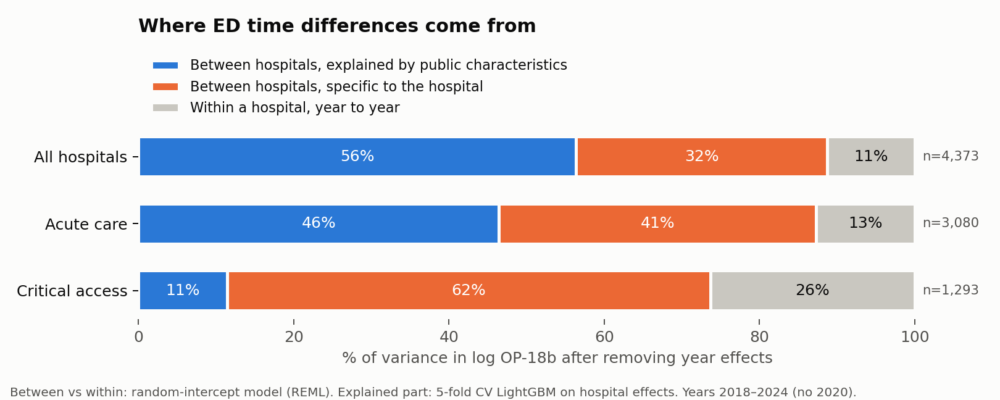

# S11: Between-hospital vs within-hospital variation

Run 2026-10-30. Code: `src/fe_decomposition.py`, `src/fe_feature_groups.py`, `src/fig_fe.py`.
Numbers: `reports/11_fe_results.json`, `reports/11_feature_groups.csv`.

## Method

Unit: hospital × calendar year, log OP-18b, acute care and critical access hospitals (24,195 hospital-years, 4,373 hospitals).

1. **Two-way fixed effects**, log y = hospital effect + year effect + residual, solved by alternating projections
   (unbalanced panel).
2. **Random-intercept model (REML)** with year fixed effects. This gives noise-corrected variances. The naive fixed-effects
   split overstates between-hospital variance, because a hospital observed for two years has a noisy average and that
   noise looks like a hospital difference.
3. **Hospital effects regressed on public characteristics** with 5-fold cross-validation (OLS and LightGBM). Explained
   variance is divided by the noise-corrected hospital variance from step 2, not by the variance of the noisy effects.

## Results

| Population | Hospitals | Year effects share | ICC (between share) | Between explained by public characteristics | Split of total (structural / hospital-specific / within) |
|---|---|---|---|---|---|
| All | 4,373 | 2.9% | **0.887** | 64% | 56% / 32% / 11% |
| Acute care | 3,080 | 4.8% | 0.873 | 53% | 46% / 41% / 13% |
| Critical access | 1,293 | 2.2% | 0.737 | **15%** | 11% / 62% / 26% |

ICC and the three-way split are computed after removing year effects. "Between explained" uses the better of OLS and
LightGBM (LightGBM in all three; OLS within 5 points, so the relationships are mostly linear).

Typical spread: one standard deviation between hospitals is about ±35% of ED time; within a hospital from year to year
about ±11%.

Year effects relative to an average year: 2018 −7.9%, 2019 −6.7%, 2021 +2.8%, 2022 +5.1%, 2023 +4.5%, 2024 +3.1%.
ED times were about 14% longer in 2022 than in 2018 (1.051 / 0.921).

## Which characteristics explain the between-hospital part

Share of the noise-corrected between-hospital variance explained, features added in order (5-fold CV LightGBM):

| Features | All | Acute care | Critical access |
|---|---|---|---|
| Hospital type | 31% | – | – |
| + state | 45% | 20% | 10% |
| + ED volume category | 58% | 43% | 11% |
| + rurality, location | 61% | 48% | 14% |
| + county population, income, insurance, age | 61% | 49% | 15% |
| + ownership | 64% | 53% | 15% |

Order matters: ED volume and county population overlap heavily, so whichever enters first takes the credit.
In S10, volume added under a minute because county population was already in the model.

## Sensitivity

| Run | ICC | Between explained | Structural / hospital-specific / within |
|---|---|---|---|
| Main | 0.887 | 64% | 56% / 32% / 11% |
| Footnoted rows and implausible jumps removed | 0.898 | 64% | 57% / 33% / 10% |
| Post-COVID only, 2021–2024 | 0.925 | 63% | 59% / 34% / 8% |
| Only hospitals with all 6 years | 0.888 | 65% | 57% / 31% / 11% |

No conclusion changes. Post-COVID years are even more stable (within share 8%).

## What this means

1. **Almost 9 of every 10 units of variation are differences between hospitals**, not changes within a hospital. This is
   the formal version of the r = 0.94 year-to-year correlation in S7.
2. **For hospitals overall, public characteristics explain most of those differences (64%)**, led by hospital type,
   state and ED volume. A third of the total is specific to the individual hospital.
3. **Critical access hospitals are the opposite.** Public characteristics explain only 15% of their between-hospital
   differences; 62% of all their variation is hospital-specific. Combined with S5 (critical access hospitals are 5.7
   times as likely to have their number suppressed), the published number carries the most unique information exactly
   where it is most often missing.
4. **Within-hospital variation is an upper bound on real change.** The 11% includes sampling noise in each year's
   median (CMS samples a few hundred charts), so true year-to-year change is smaller still.

## How this squares with S10

S10: beyond state and type, the remaining public characteristics close about 20% of the *error gap* to knowing the
hospital. S11: of the *variance* between hospitals, public characteristics explain 64% overall, but state and type alone
already account for 45 points of that. The two are consistent: most of what public data can explain is captured by type
and state; the rest of the data adds a little; a large hospital-specific part remains.
