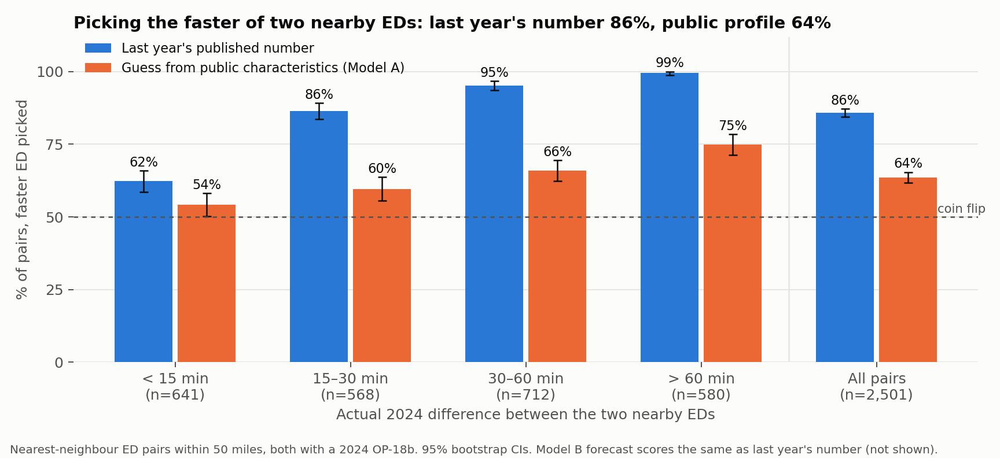

# S12–S13: Nearby ED pairs and the patient's choice

Run 2026-10-31. Code: `src/build_pairs.py`, `src/decision_eval.py`, `src/fig_decision.py`.
Outputs: `reports/13_decision.csv`, `data/interim/hospital_pairs.parquet`, `data/interim/pair_decisions_2024.parquet`.

## S12: Pairing each ED with its nearest alternative

**Pool:** 4,174 hospitals that are acute care, critical access or DoD, appear in the most recent CMS hospital list
(2026-08-13) and list emergency services. **Distance:** great-circle miles between ZIP centroids (county centroid for 110 hospitals and Connecticut
town centroid for 6, where the ZIP has no centroid), so distances are approximate to a few miles.

Each hospital is paired with its nearest other ED; A→B and B→A count once. **2,980 unique pairs**; 47 are farther than
50 miles apart (islands, remote Alaska, the high desert) and are flagged as not a realistic alternative.

Median distance to the nearest ED: metro 5.7 mi, nonmetro adjacent/large 17.8 mi, rural 20.7 mi;
acute care 6.8 mi, critical access 19.5 mi. 42% of hospitals have another ED within 10 miles, 87% within 25.

**Hand check (gate).** A first pass was checked against 20 random pairs plus every pair over 75 miles. It found:
1. *Self-pairs.* When several hospitals share a ZIP centroid, the nearest-neighbour search can return a neighbour before
   the hospital itself; taking "the second result" then paired a hospital with itself (e.g. Carle Foundation Hospital).
   Fixed by explicitly excluding self; asserted in code.
2. *Stale hospitals.* Lakeway Regional (Morristown TN) was last listed by CMS in 2019 but was still in the pool.
   Fixed by requiring presence in the latest list.
3. *Island pairs* such as American Samoa → Hawaii (2,541 mi). Flagged by the 50-mile rule.

Known remaining limits: Wiregrass Medical Center (Geneva AL) is listed under two current IDs; some "nearest EDs" are
specialty hospitals (e.g. a spine hospital) that most patients would not choose.

## S13: Would the numbers have sent a patient to the faster ED?

For each realistic pair where both EDs have a 2024 OP-18b and every signal is available (**2,501 pairs**): which ED was
faster in 2024, and did the signal pick it? Ties in a signal count as half right. "Minutes saved" compares the ED the
signal picks with a coin flip; the best possible saving (always picking the faster ED) is 20.4 minutes on average.

| Signal | % of pairs, faster ED picked [95% CI] | Minutes saved vs coin flip [95% CI] | Share of best possible saving |
|---|---|---|---|
| **Last year's published number** | **85.8 [84.5, 87.1]** | **18.5 [17.7, 19.3]** | **91%** |
| Model B forecast | 86.1 [84.8, 87.4] | 18.5 [17.7, 19.3] | 91% |
| Model A, public characteristics only (cross-fitted, never saw the hospital) | 63.6 [61.7, 65.4] | 7.9 [6.9, 8.9] | 39% |
| Coin flip | 50 | 0 | 0% |

The actual difference between two nearby EDs in 2024 had a median of 32 minutes (IQR 15–57).

### By how different the two EDs really were

| Actual 2024 difference | Pairs | Last year's number | Model A |
|---|---|---|---|
| < 15 min | 641 | 62.4% | 54.1% |
| 15–30 min | 568 | 86.4% | 59.6% |
| 30–60 min | 712 | 95.2% | 66.0% |
| > 60 min | 580 | 99.5% | 74.8% |

### By pair type, distance and rurality (last year's number)

| Subset | Pairs | % correct | Minutes saved |
|---|---|---|---|
| Acute care only | 1,522 | 86.1 | 19.9 |
| Involves a critical access hospital | 979 | 85.2 | 16.3 |
| < 5 miles apart | 586 | 85.1 | 21.9 |
| 5–15 miles | 814 | 87.8 | 19.0 |
| 15–50 miles | 1,101 | 84.7 | 16.3 |
| Metro | 1,524 | 86.8 | 20.9 |
| Rural | 513 | 81.9 | 12.6 |

### The information gap

Among the 2,933 realistic pairs, the share where a patient would have **both** EDs' prior-year numbers to compare:

| | Pairs | Both numbers available |
|---|---|---|
| Hospital A in a metro county | 1,730 | 88.1% |
| Nonmetro adjacent/large | 555 | 83.6% |
| Rural | 648 | 79.2% |
| Acute care only | 1,692 | 90.0% |
| Involves a critical access hospital | 1,241 | 78.9% |

## What this means

1. **Last year's published number would have pointed a patient to the faster nearby ED 86% of the time**, capturing
   91% of the best possible time saving (18.5 of 20.4 minutes on average). When the two EDs really differ by more than
   30 minutes, it is right 95–99% of the time.
2. **A model can't improve on it.** The Model B forecast scores the same; this matches S10.
3. **A guess from the hospital's public profile is much worse:** 64% right and 39% of the saving. The posted number
   carries information a patient could not infer, which is what S11 found as variance and S13 shows as a decision.
4. **When two EDs are within 15 minutes of each other, nothing reliably picks the faster one** (62%). The number is useful
   for telling apart EDs that really differ, not for fine distinctions.
5. **The gap lands where alternatives are fewest.** About 1 in 5 pairs involving a critical access hospital, or in a
   rural county, lack one of the two numbers; for acute-only pairs it is 1 in 10.

## Limits

- **OP-18b is not a live wait time.** It is the median time from arrival to leaving the ED for discharged patients over a
  year, including treatment time. "Faster" here means faster on that annual median, not at a given hour on a given night.
- One alternative per hospital (the nearest); a real patient may have several.
- Distances are between ZIP centroids, not driving times.
- Pairs are scored where both 2024 values exist, so the information gap above is excluded from the accuracy numbers.
