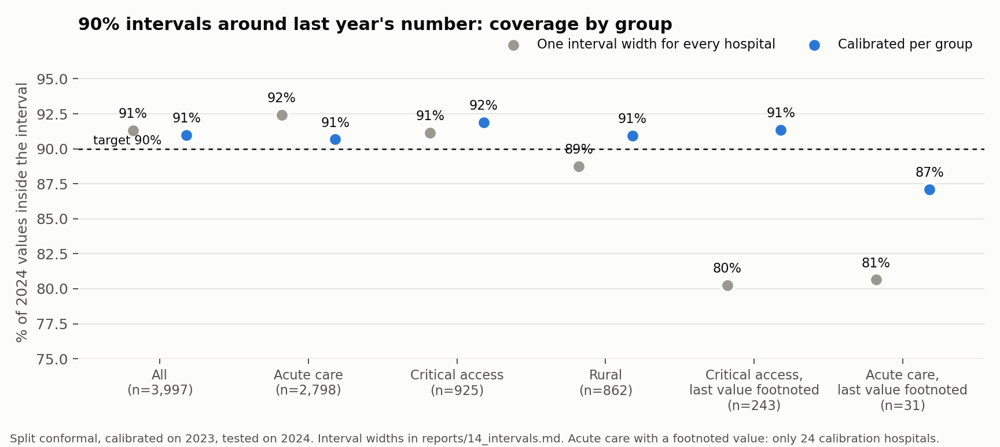

# S14: Prediction intervals

Run 2026-11-01. Code: `src/conformal.py`, `src/fig_conformal.py`. Outputs: `reports/14_coverage.csv`,
`reports/14_conformal_quantiles.json`, `data/interim/intervals_2024.parquet` (one row per 2024 hospital, for the app).

## Method

Split conformal on the log scale. Calibrate on 2023 errors, test once on 2024.

- **Around last year's number** (persistence). For hospitals with a published value. No fitted model, so 2023 errors
  are genuinely out of sample.
- **Around the public-profile estimate** (Model A settings, cross-fitted by hospital in 5 folds, trained only on years
  before the target year). For hospitals with no published value. Every hospital is predicted by a model that never
  saw it.

Residual = log(actual) − log(forecast). The interval is forecast × exp([q_lo, q_hi]), with q_lo and q_hi the
finite-sample conformal quantiles at α/2 and 1 − α/2, so it can be lopsided.

**Marginal**: one pair of quantiles for every hospital. **Calibrated per group** (Mondrian): separate quantiles for
hospital type × whether last year's number carried a CMS footnote. Both are known before the target year.

Implemented by hand rather than with MAPIE: one forecast is not a fitted model and the other is five cross-fitted
models, which don't fit a single-estimator API; the implementation is ~15 lines (`conf_q` in `src/conformal.py`).

## Results, 90% intervals, 2024

| Forecast | Group | n | Coverage, one width | Coverage, per group | Median width, per group |
|---|---|---|---|---|---|
| Last year's number | All | 3,997 | 91.3% | 91.0% | 49.5 min |
| | Acute care | 2,798 | 92.4% | 90.7% | 53.8 min |
| | Critical access | 925 | 91.1% | 91.9% | 38.8 min |
| | Rural | 862 | 88.7% | 91.0% | 41.3 min |
| | Critical access, last value footnoted | 243 | **80.2%** | **91.4%** | 59.0 min |
| | Acute care, last value footnoted | 31 | 80.6% | 87.1% | 68.7 min |
| Public profile | All | 4,052 | 90.1% | 90.2% | 105.8 min |
| | Acute care | 2,813 | 90.3% | 90.5% | 118.7 min |
| | Critical access | 965 | 90.8% | 90.7% | 75.4 min |

80% intervals: last year's number 82.3% coverage (median width 37.8 min); public profile 80.8% (81.1 min).

In multiplicative terms, the per-group 90% interval around last year's number runs from 0.85× to 1.16× for acute care,
0.83× to 1.17× for critical access, and 0.76× to 1.28× for critical access hospitals whose last value was footnoted.
Around the public-profile estimate it runs about 0.71× to 1.40× for acute care.

Example from the test set: last year 181 min → 90% interval 153–209 min; actual 2024: 161.

## What this means

1. **Coverage holds on a year the calibration never saw.** 91% for a 90% target, 82% for 80%, despite 2024 being a
   different year from 2023.
2. **The hypothesis I set out to test was wrong.** One width for all does not under-cover critical access hospitals
   (91.1%). The group it fails is **hospitals whose last number carried a CMS footnote** (80%). Calibrating per group
   fixes it by widening their intervals from about 38 to 59 minutes.
3. **The footnote is a usable warning sign.** A footnoted number (often "based on a shorter period than required")
   should be shown with a wider interval, and the app will do that.
4. **The public-profile estimate is honest but wide.** About twice as wide as the interval around last year's number
   (106 vs 50 minutes). For a suppressed hospital, that is the true state of knowledge, and the app should show it as such.
5. **Small group warning.** Acute care hospitals with a footnoted value: 24 calibration and 31 test hospitals. Their
   87% coverage is too uncertain to read much into.

## Limits

- Calibration assumes 2023→2024 errors resemble 2024→2025 errors. A shock like 2020 would break that, as it would any
  forecast.
- Coverage is marginal within each group, not guaranteed for any single hospital.
