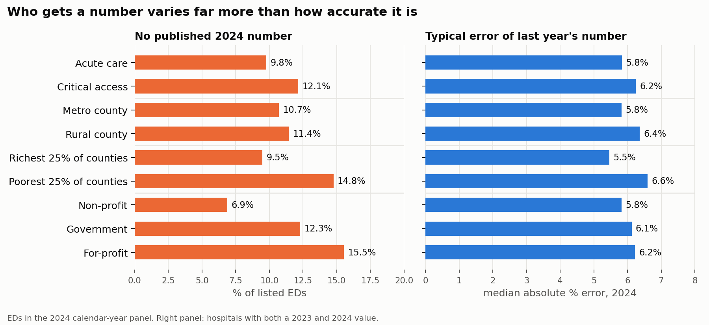

# S15: Who does it work worse for?

Run 2026-11-01. Code: `src/slices.py`, `src/fig_slices.py`. Full table: `reports/15_slices.csv`.

Three questions per group, all on 2024: Does the group have a published number? How accurate is last year's number?
Does it pick the faster nearby ED? Plus interval coverage and the public-profile estimate.
Minute errors are confounded with level (critical access EDs are faster, so minute errors are smaller), so every
slice also reports median absolute percent error.

## Results (last year's number unless stated)

| Group | Listed EDs | No 2024 number | MAE (min) | Median % error | 90% coverage | Faster ED picked | Median true gap in pair |
|---|---|---|---|---|---|---|---|
| Acute care | 3,152 | 9.8% | 12.9 | 5.8% | 90.6% | 86.6% | 34 min |
| Critical access | 1,375 | 12.1% | 9.4 | 6.2% | 91.8% | 83.9% | 25 min |
| Metro county | 2,733 | 10.7% | 13.1 | 5.8% | 90.8% | 86.8% | 36 min |
| Rural county | 997 | 11.4% | 9.6 | 6.4% | 91.0% | 81.9% | 22 min |
| Richest 25% of counties | 1,138 | 9.5% | 12.6 | 5.5% | 92.2% | 87.1% | 36 min |
| Poorest 25% of counties | 1,111 | **14.8%** | 11.4 | 6.6% | 89.8% | 85.6% | 30 min |
| Most-insured 25% of counties | 1,151 | 10.1% | 12.4 | 5.9% | 92.4% | 87.3% | 34 min |
| Least-insured 25% of counties | 1,087 | 12.7% | 11.7 | 6.3% | 88.6% | 86.0% | 29 min |
| Non-profit | 2,729 | 6.9% | 12.0 | 5.8% | 91.6% | 86.2% | 33 min |
| Government | 960 | 12.3% | 11.4 | 6.1% | 89.9% | 84.6% | 28 min |
| For-profit | 714 | **15.5%** | 11.9 | 6.2% | 90.4% | 85.6% | 32 min |
| ED volume not reported | 704 | **56.4%** | 12.0 | 6.6% | 87.9% | 87.4% | 29 min |

Income quartile cutoffs (county median household income): $56,882 / $66,085 / $78,827.
Uninsured cutoffs: 5.5% / 8.1% / 11.5%.

Public-profile estimate: median % error 12.1–14.3% in every group, 90% coverage 87.2–92.5%.

## Is the number worse in rural areas?

Unadjusted, it looks like it: rural pairs pick the faster ED 81.9% of the time vs 86.8% in metro areas
(odds ratio 0.70 [0.53, 0.93], p = 0.013). But nearby rural EDs are more alike (median gap 22 vs 36 min), and S13 showed
accuracy depends on the gap. Adjusting for the actual gap (logistic regression on log(1 + gap)):
**odds ratio 1.01 [0.74, 1.38], p = 0.95.** Within each gap size, rural accuracy matches metro
(e.g. 15–30 min gap: 86.0% both). The number is not worse in rural areas; the choice is harder.

## What this means

1. **Accuracy is close to even.** The typical error of last year's number is 5.5–6.6% in every group, and 90% coverage
   is 87.9–92.4%. The poorest counties have the highest relative error (6.6% vs 5.5% in the richest), a real but small
   difference.
2. **Who gets a number is not even.** For-profit EDs (15.5%) and EDs in the poorest counties (14.8%) are more than twice
   as likely as non-profits (6.9%) to have no 2024 number. Where ED volume is not reported, most have no number either.
3. **The rural decision gap is a property of the choice, not the data.** It disappears once the true gap is accounted for.
4. **Read with S5 and S13:** the measurable inequity in this system is missing information, concentrated in smaller,
   poorer, for-profit and critical access EDs, rather than worse predictions for them.

## Limits

- Groups overlap (critical access hospitals are mostly rural); each slice is shown on its own, not adjusted for the others.
- County income and insurance describe the county, not the hospital's patients.
